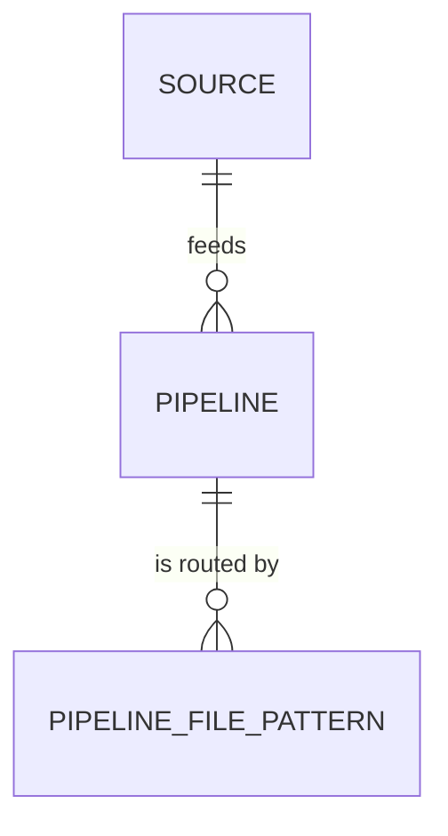

# 01_config: `config` schema

Configuration covers what varies by source, **which sources exist, which pipelines they feed, how an arriving file is routed, and which sources take part in entity resolution (in what order)**, plus **the QC checks**, each stored as the literal SQL it runs, and **every tunable matching value** (thresholds, weights, comparison methods, strong identifiers, common-word cut-off). Everything after bronze is code. All configuration lives in the `config` schema and is seeded by [01_seeds/](01_seeds/). Back to [database migrations](../README.md).

| Table file | Seed file |
|---|---|
| [001_source.sql](00_tables/001_source.sql) | [001_source.sql](01_seeds/001_source.sql) |
| [002_pipeline.sql](00_tables/002_pipeline.sql) | [002_pipeline.sql](01_seeds/002_pipeline.sql) |
| [003_pipeline_file_pattern.sql](00_tables/003_pipeline_file_pattern.sql) | [003_pipeline_file_pattern.sql](01_seeds/003_pipeline_file_pattern.sql) |
| [004_entity_resolution_order.sql](00_tables/004_entity_resolution_order.sql) | [004_entity_resolution_order.sql](01_seeds/004_entity_resolution_order.sql) |
| [005_qc_check.sql](00_tables/005_qc_check.sql) | [005_qc_check.sql](01_seeds/005_qc_check.sql) |
| [006_entity_match_setting.sql](00_tables/006_entity_match_setting.sql) | [006_entity_match_setting.sql](01_seeds/006_entity_match_setting.sql) |
| [007_entity_match_attribute.sql](00_tables/007_entity_match_attribute.sql) | [007_entity_match_attribute.sql](01_seeds/007_entity_match_attribute.sql) |

## Tables

**`config.source`**: one row per source system.

| Column | Description |
|---|---|
| `source_id` | PK, explicit id |
| `source_name` | `part1_company`, `salesforce`. Also the `source_system` value in the crosswalk |
| `description`, `is_active`, `created_at`, `updated_at` | |

**`config.pipeline`**: one row per pipeline. Each source has its own pipelines, so a change in one source never affects another.

| Column | Description |
|---|---|
| `pipeline_id` | PK, explicit id |
| `pipeline_name` | e.g. `inbound_company` |
| `source_id` | FK → `config.source` |
| `bronze_table_name` | Where its rows land, e.g. `bronze.inbound_company_raw` |
| `description`, `is_active`, `created_at`, `updated_at` | |

**`config.pipeline_file_pattern`**: routes an arriving file to its pipeline.

| Column | Description |
|---|---|
| `pipeline_file_pattern_id` | PK, explicit id |
| `pipeline_id` | FK → `config.pipeline` |
| `file_pattern` | Glob matched against the **original** file name (case-insensitive) |
| `description`, `is_active`, `created_at`, `updated_at` | |

A file must match **exactly one** active pattern, otherwise it fails routing. `person.csv` is exact on purpose: `person*.csv` would also match `persontocompany.csv`.

**`config.entity_resolution_order`**: which sources take part in resolving each entity type, and in what order. Grain is source × entity type, because participation differs: the provider feed is the reference for companies and people, Salesforce only takes part in companies, and person-company links or a lookup feed take part in none (no row).

| Column | Description |
|---|---|
| `entity_type` | `company` or `person` (PK with `source_id`) |
| `source_id` | FK → `config.source` |
| `resolution_order` | 1 = the reference, resolved first among itself; higher numbers are matched onto what is already resolved. Gold uses the same order to pick values (the reference source's value wins, others fill gaps) |
| `is_active`, `created_at`, `updated_at` | |

| `entity_type` | Source | `resolution_order` |
|---|---|---|
| company | `part1_company` | 1 (Part 1 deduplicated first) |
| company | `salesforce` | 2 (matched onto Part 1) |
| person | `part1_company` | 1 |

**`config.qc_check`**: one row per QC check, with the literal SQL it runs.

| Column | Description |
|---|---|
| `qc_check_id` | PK, explicit id (also the run order) |
| `check_name` | e.g. `shared_domain` |
| `check_type` | `over_merge` / `under_merge` / `cross_attribute` / `integrity` |
| `creates_review` | Open a review queue entry for each finding |
| `description` | What the check flags |
| `check_sql` | The query; returns `(entity_type, entity_id, related_entity_id, transaction_id, detail)` for each row that breaks the rule |
| `is_active`, `created_at`, `updated_at` | |

The 14 checks and their meaning: [Quality Control Design](../../03_silver/docs/Quality-Control-Design.md).

### Matching settings

Read by the matching engine at the start of every run, so tuning matching is a seed change, never a code change.

**`config.entity_match_setting`**: one row per entity type.

| Column | Description | company | person |
|---|---|---|---|
| `entity_type` | PK | `company` | `person` |
| `id_prefix` | Master id prefix | `CMP` | `PER` |
| `auto_match_threshold` | Score at or above which a match is automatic (if a strong identifier agrees) | 90 | 90 |
| `review_threshold` | Score at or above which a match goes to manual review | 70 | 70 |
| `review_candidates` | Candidates kept per review (1–3) | 3 | 3 |

**`config.entity_match_attribute`**: one row per entity type × match attribute. Weights are relative: a score is the weighted average over the attributes both records have.

| `entity_type` | `attribute_name` | `weight` | `comparison_method` | `is_strong_identifier` |
|---|---|---|---|---|
| company | `name` | 40 | `token_set` (word sets: extra words and word order don't hurt); `common_word_pct` = 2 | |
| company | `domain` | 30 | `exact` | yes |
| company | `phone` | 20 | `exact` | yes |
| company | `city`, `state` | 5 each | `exact` | |
| person | `last_name` | 30 | `jaro_winkler` (short names, typos) | |
| person | `first_name` | 20 | `jaro_winkler` | |
| person | `linkedin` | 20 | `exact` | yes |
| person | `email` | 15 | `exact` | yes |
| person | `company` (resolved company id) | 30 | `exact` | |

`common_word_pct`: words found in at least this % of the attribute's values are ignored when comparing (for company names: inc, llc, the, group, …). Computed from the data on every run, so there is no word list to maintain. NULL keeps every word.

An attribute must be a column of `<entity_type>_match_input`; the engine refuses to run otherwise.

## Seeded values

| `pipeline_id` | `pipeline_name` | Source | File pattern | Bronze table |
|---|---|---|---|---|
| 1 | `inbound_company` | `part1_company` | `company*.csv` | `bronze.inbound_company_raw` |
| 2 | `inbound_person` | `part1_company` | `person.csv` | `bronze.inbound_person_raw` |
| 3 | `inbound_person_company` | `part1_company` | `persontocompany*.csv` | `bronze.inbound_person_company_raw` |
| 4 | `inbound_salesforce_account` | `salesforce` | `account*.csv` | `bronze.inbound_salesforce_account_raw` |

## Changing configuration

Seeds use **explicit ids** and `INSERT … ON CONFLICT (id) DO UPDATE`, so editing a seed file and re-running the migrations updates the table in place.

| To… | Do |
|---|---|
| Accept a new file name for an existing pipeline | Add a row to `003_pipeline_file_pattern.sql` |
| Pause a pipeline | Set `is_active = false` in `002_pipeline.sql` |
| Tune matching (threshold, weight, common-word cut-off) | Edit `006`–`007`, then re-run from a fresh database (decisions already made are not re-scored) |
| Add a new source | Add rows to `001_source.sql`, `002_pipeline.sql`, `003_pipeline_file_pattern.sql`, add its bronze table to `00_database/03_bronze/00_tables/`, then add its silver load and matching code |
