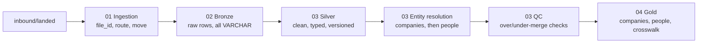

# Entity Resolution Pipeline

Turns raw company, person and Salesforce data into trusted **golden** company and person records, with an auditable **crosswalk** from every source record to its golden record.

## Start here (a 10-minute review)

| Read | Why |
|---|---|
| 1. [Submission Write-Up](Submission-Write-Up.md) | My answers to the Part 1 and Part 2 write-up questions |
| 2. This README: [High-level process](#high-level-process) and [Results](#results-on-the-assessment-data) | What happens and what comes out |
| 3. [run_pipeline.py](run_pipeline.py) | The whole run: three calls, bronze → silver → gold |
| 4. Each layer's orchestrator: [intake_files.py](01_ingestion/intake_files.py), [load_bronze.py](02_bronze/load_bronze.py), [load_silver.py](03_silver/load_silver.py), [load_gold.py](04_gold/load_gold.py) | Each lists its steps at the top |
| 5. `decide()` in [entity_matching_engine.py](03_silver/functions/entity_matching_engine.py), and the [matching configuration](00_database/01_config/README.md#matching-settings) | Every matching rule in one function; every weight and threshold in config tables |
| 6. [005_crosswalk.sql](04_gold/sql/005_crosswalk.sql) and [04_gold/tests/](04_gold/tests/) | The Part 2 crosswalk and the tests that block publication |
| 7. [Pipeline Design](docs/design/Pipeline-Design.md) | The why behind each choice, with links to each layer's design |
| 8. [Ad Hoc Analysis](docs/analysis/Ad-Hoc-Analysis.md) | The queries I used to check the data and make the matching decisions |

**Where each deliverable is:**

| The brief asks for | Here |
|---|---|
| Part 1: final companies table, people table | `gold.part1_company` (the Part 1 companies), `gold.person` (built by [04_gold/sql/](04_gold/sql/)); `gold.company` has every company, including Salesforce-only |
| Part 1: deduplication and field merging | Company matching ([resolve_company_entities.py](03_silver/functions/resolve_company_entities.py)) and survivorship ([001_company.sql](04_gold/sql/001_company.sql)) |
| Part 1: data-quality summary | `gold.data_quality_summary` ([006_data_quality_summary.sql](00_database/07_gold/00_tables/006_data_quality_summary.sql)): rows in vs out and QC findings per check, also printed at the end of every pipeline run |
| Part 1: ≥ 3 data-quality tests | [04_gold/tests/](04_gold/tests/) (8 tests) and the QC checks in `config.qc_check` |
| Part 2: matching in Python | [03_silver/functions/](03_silver/functions/) |
| Part 2: crosswalk | `gold.crosswalk` ([005_crosswalk.sql](04_gold/sql/005_crosswalk.sql)) |

## What you need

| Requirement | Version | Used for |
|---|---|---|
| Python | 3.12+ (tested on 3.13) | Pipeline code |
| Python packages | Pinned in `requirements.txt` | `prefect==3.7.8` (orchestration), `duckdb==1.5.6` (the database, a single file), `rapidfuzz==3.14.1` (name similarity) |

## Setup

Run from the repository root. There is no database server: the whole database is one DuckDB file, `00_database/pipeline.duckdb`.

1. Create the virtual environment and install dependencies:

   ```bash
   python3 -m venv .venv && .venv/bin/pip install -r requirements.txt
   ```

2. Create the database: every schema, table and config row (safe to re-run; `--fresh` deletes the file and starts empty):

   ```bash
   .venv/bin/python 00_database/create_database.py --fresh
   ```

To look at the data, open the file with the DuckDB CLI (`duckdb 00_database/pipeline.duckdb`) or from Python (`duckdb.connect("00_database/pipeline.duckdb")`). Close it before running the pipeline: DuckDB allows one writing process at a time.

## Running

Two separate steps, each a Prefect flow:

1. **File intake:** put source files in `inbound/landed/` (e.g. the four CSVs in `sample_data/`), then:

   ```bash
   .venv/bin/python run_file_intake.py
   ```

   Each file gets a `file_id` and moves to `inbound/<source>/<YYYY-MM-DD>/` (ready for the pipeline), or to `inbound/unmatched/<YYYY-MM-DD>/` if no pipeline is configured for its name.

2. **Pipeline run:**

   ```bash
   .venv/bin/python run_pipeline.py
   ```

| Command | Does |
|---|---|
| `.venv/bin/python run_file_intake.py` | Takes in every file in `inbound/landed/` |
| `.venv/bin/python run_file_intake.py --serve` | File intake every 5 minutes |
| `.venv/bin/python run_pipeline.py` | Bronze → silver → companies → people → QC → gold |
| `.venv/bin/python run_pipeline.py --rerun FILE_ID` | Same, re-loading one existing file into bronze |
| `.venv/bin/python run_pipeline.py --serve` | Pipeline run every 5 minutes |
| `.venv/bin/prefect server start` | Optional: Prefect UI with run history at http://127.0.0.1:4200 |

Prefect runs flows locally without a server; it starts a temporary one by itself.

## High-level process



1. **Ingestion** (file intake): each file in `inbound/landed/` is registered (gets a `file_id`), routed by file name (`config.pipeline_file_pattern`) and moved to its source folder or `unmatched/`.
2. **Bronze**: every row of every `arrived` file is stored exactly as received, with a `transaction_id` (`{file_id}-{row_number}`) and a row hash.
3. **Silver**: values are trimmed, typed and versioned; problems are logged as warnings, never rejected.
4. **Entity resolution**: exact match first, then a weighted 0–100% score. ≥ 90% auto-matches, 70–89% goes to manual review, < 70% becomes a new entity.
5. **QC**: checks for over-merges, under-merges and data issues; merge findings go to the review queue.
6. **Gold**: final `company`, `person`, `person_company` and `crosswalk` tables, published only if all tests pass.

## Results on the assessment data

| Output | Count |
|---|---|
| Part 1 deduplication | 1,024 provider rows → 1,005 companies (`gold.part1_company`) |
| Companies (after Salesforce) | 1,017 (88 in both systems, 917 provider only, 12 Salesforce only) |
| People | 1,869 |
| Affiliations | 1,870 (113 duplicate person × company links collapsed) |
| Crosswalk rows | 1,124 (1,024 Part 1 company ids, 100 Salesforce accounts) |
| Pending manual review | 21 transactions |
| Gold tests | 8 of 8 passing |

## Folder layout

| Folder | Contains |
|---|---|
| `run_file_intake.py` | Entry point: file intake (runs `01_ingestion/intake_files.py`) |
| `run_pipeline.py` | Entry point: the pipeline run (runs `load_bronze`, `load_silver`, `load_gold` in order) |
| `01_ingestion/` | **`intake_files.py`** (orchestrator), `functions/`, `docs/` |
| `02_bronze/` | **`load_bronze.py`** (orchestrator), `functions/`, `docs/` |
| `03_silver/` | **`load_silver.py`** (orchestrator: silver load, entity resolution, QC), `functions/`, `sql/` (one file per step), `docs/` |
| `04_gold/` | **`load_gold.py`** (orchestrator: build and tests), `sql/` (one file per step), `tests/`, `docs/` |
| `shared/` | Code used by more than one layer: database connection, running SQL step files |
| `00_database/` | `create_database.py` and the SQL scripts it runs in folder order to create every schema, table and config row; also holds the database file `pipeline.duckdb` (not committed) ([how they work](00_database/README.md)); each schema folder has a README, e.g. [configuration](00_database/01_config/README.md) |
| `Submission-Write-Up.md` | The Part 1 and Part 2 write-ups |
| `docs/design/` | [Pipeline Design](docs/design/Pipeline-Design.md) (what is built); `archive/` holds an earlier, fully config-driven design written for PostgreSQL |
| `docs/analysis/` | [Ad Hoc Analysis](docs/analysis/Ad-Hoc-Analysis.md): the queries behind the matching decisions |
| `inbound/` | `landed/` (arriving files), `<source>/` (routed), `unmatched/`; contents not committed |
| `docs/assessment/` | The assessment brief and problem breakdown |
| `sample_data/` | The candidate data package (CSVs, DuckDB file, README): copy the CSVs into `inbound/landed/` to run |

Each layer has one orchestrator at the top of its folder that ties its steps together; helpers live in `functions/`. Folders are numbered in run order: `00_database` first (migrations), then the four layers. Because their names start with a digit, the entry points load them with `importlib`; inside a layer, modules import each other relatively.
