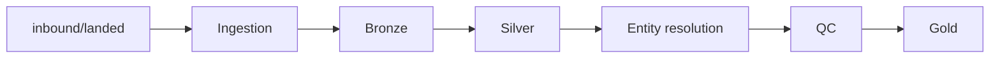

# Pipeline Design

The design as built. Configuration covers sources, pipelines, file routing, entity resolution order, matching settings (thresholds, weights, comparison methods) and QC checks; the silver loads and gold builds are plain SQL and Python. An earlier, fully config-driven production design (written for PostgreSQL) is archived in [Config-Driven Pipeline Design](archive/Config-Driven-Pipeline-Design.md).

## Goal

Resolve every company and person record, across the provider feed and Salesforce, to one **golden** record, and keep an auditable **crosswalk** from every source record to it.

## Flow

Two Prefect flows: **file intake** (`intake-files`, [run_file_intake.py](../../run_file_intake.py)) gets files ready, and the **pipeline run** (`run-pipeline`, which runs each layer's orchestrator: `02_bronze/load_bronze.py`, `03_silver/load_silver.py`, `04_gold/load_gold.py`; [run_pipeline.py](../../run_pipeline.py)) does bronze through gold. In production each runs on a schedule (every 5 minutes); for the assessment they are run by hand.

| Step | What happens | Detail |
|---|---|---|
| **Ingestion** (file intake) | Each file in `inbound/landed/` gets a `file_id`, is routed by file name, and moves to `inbound/<source>/YYYY-MM-DD/{file_id}_{name}` or `inbound/unmatched/` | [Ingestion Design](../../01_ingestion/docs/Ingestion-Design.md) |
| **Bronze** | Every row stored exactly as received (all VARCHAR), with `transaction_id` and `row_hash` | [Bronze Design](../../02_bronze/docs/Bronze-Design.md) |
| **Silver** | Trimmed, typed, versioned records; problems are warnings, never rejections | [Silver Design](../../03_silver/docs/Silver-Design.md) |
| **Entity resolution** | Companies, then people. Companies in two stages: Part 1 resolved first, then Salesforce matched onto it. Exact match, then a weighted 0–100% score with three bands | [Entity Resolution Design](../../03_silver/docs/Entity-Resolution-Design.md) |
| **QC** | Over-merge, under-merge and data checks; merge findings go to manual review | [Quality Control Design](../../03_silver/docs/Quality-Control-Design.md) |
| **Gold** | Final companies, people, affiliations and crosswalk (full refresh) | [Gold Design](../../04_gold/docs/Gold-Design.md) |

## Key concepts

| Concept | Meaning |
|---|---|
| `file_id` | One per arriving file. Every arrival is a new file, even with the same name |
| `transaction_id` | One per row received: `"{file_id}-{row_number}"`. The key through bronze, silver and matching |
| `source_record_key` | One per source record across all its versions: `"{source_id}-{source id}"` |
| `source_record_version` | 1, 2, 3… each time a source resends the same record. Gold uses the latest |
| Master id | The golden id: `CMP-000001`, `PER-000001`. Never reused or renumbered |
| Crosswalk | One row per source record → its master id, with match confidence and basis |

## Schemas

| Schema | Contains | Created by |
|---|---|---|
| `config` | Sources, pipelines, file patterns, entity resolution order, matching settings, QC checks | `00_database/01_config` (+ seeds) |
| `ingestion` | File log, failure log | `00_database/02_ingestion` |
| `bronze` | `inbound_*_raw` tables | `00_database/03_bronze` |
| `silver` | `company`, `account`, `person`, `person_company` | `00_database/04_silver` |
| `entity_resolution` | Per domain: master ids, match inputs, results, review queue, alias | `00_database/05_entity_resolution` |
| `qc` | Silver validation warnings, check findings | `00_database/06_qc` |
| `gold` | `company`, `person`, `person_company`, `crosswalk`; views `part1_company`, `data_quality_summary` | `00_database/07_gold` |

## Re-runs

| Layer | On re-run of an existing `file_id` |
|---|---|
| Bronze | Delete that file's rows and re-insert |
| Silver | Loads only bronze rows not yet in silver (keyed on `transaction_id`); a re-run has identical content |
| Entity resolution | Transactions with a result are skipped, so earlier decisions are never re-scored |
| Gold | Full refresh |

## Built vs. production design

| Area | Built here | Production design |
|---|---|---|
| Sources, pipelines, file routing | Config tables | Same |
| Bronze tables | Fixed DDL | Generated from config |
| Silver mappings, transforms, validations | Hardcoded SQL | Config tables and a rule catalog |
| Match weights, thresholds, comparison methods | Config tables | Same |
| QC checks | Config table (SQL per check) | Same |
| Gold mappings | Hardcoded SQL | Config tables |

Hardcoding past bronze keeps the code short and easy to follow; the production design shows how the same pipeline scales to new sources and entities without code changes.

## Calibration

Company weights were calibrated on the known provider duplicates and Salesforce traps; person weights on the data's namesakes (the resolved company is weighted 30 so people with the same name at different companies stay separate). The queries behind these choices: [Ad Hoc Analysis](../analysis/Ad-Hoc-Analysis.md).
