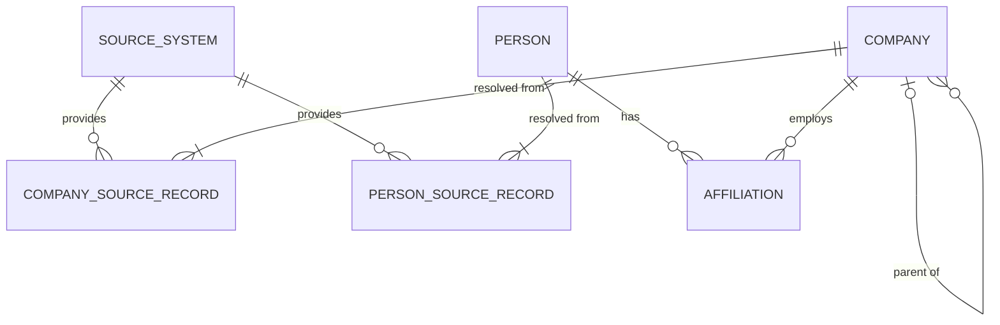

# Config-Driven Pipeline Design

Design for turning the raw company, person and Salesforce data into trusted golden company and person records, with an auditable mapping from every source record to its golden record.

This is the **production design**: every layer is driven by configuration. The version actually built is simpler (config for sources, pipelines and file routing only); see [Pipeline Design](../Pipeline-Design.md).

| Section | Status |
|---|---|
| 1. Configuration and Schema Layout | Approved |
| 2. Source Records (conceptual model) | Approved |
| 3. Bronze Layer | Approved |
| 4. Silver Layer (incl. entity resolution) | Approved |
| 4.10 Quality control | Draft, pending review |
| 5. Gold Layer | Draft, pending review |

---

## 1. Configuration and Schema Layout

Cross-layer setup: which schemas exist and the configuration that drives every layer.

### 1.1 Schema layout

Each schema holds only its own kind of table.

| Schema | Contains |
|---|---|
| `config` | All configuration tables |
| `ingestion` | File arrival and load logs |
| `bronze` | Only `*_raw` tables |
| `silver` | Only silver entity tables |
| `gold` | Only gold tables |
| `entity_resolution` | Per domain (company, person): master id registry, match inputs, match results, review queue, alias. Detailed under Silver |
| `qc` | Over-merge / under-merge checks and data-quality findings. Detailed under Silver / Gold as needed |

**Table creation.** `bronze`, `silver` and `gold` tables are **created automatically from configuration** (bronze from `config.pipeline_bronze_column`, silver from `config.silver_entity_attribute`, gold from `config.gold_entity_attribute`, each plus its standard metadata columns). `config`, `ingestion`, `entity_resolution` and `qc` tables are created by the migration scripts in `00_database/`. The database is **PostgreSQL**.

Naming rules: table names are always meaningful and descriptive. Config tables follow `<owning object>_<what it configures>`, with no `cfg_` prefix since the schema already says it.

### 1.2 Config tables

All configuration lives in the `config` schema.

| Table | Grain | Key columns / purpose |
|---|---|---|
| `config.source` | One row per source system | `source_id`, `source_name` (`part1_company`, `salesforce`), `survivorship_priority`. Every record can always be traced to its source |
| `config.pipeline` | One row per pipeline | `pipeline_id`, `pipeline_name`, `source_id`, active flag. Each source has its own pipelines, so a schema difference in one source never affects another |
| `config.pipeline_file_pattern` | One row per file pattern | `pipeline_id`, file name / path pattern. Routes an arriving file to its pipeline; kept separate so one pipeline can accept several patterns |
| `config.pipeline_bronze_column` | One row per pipeline × source column | `pipeline_bronze_column_id`, `pipeline_id`, `column_name`, `ordinal`. Every column the source file carries (all 269 for Salesforce); the bronze table is created from it |
| `config.silver_entity` | One row per silver entity | `silver_entity_id`, `entity_name`, `silver_table_name`, active flag |
| `config.silver_entity_attribute` | One row per silver entity attribute | `silver_entity_attribute_id`, `silver_entity_id`, `attribute_name`, `data_type`, `ordinal` |
| `config.pipeline_silver_attribute_mapping` | One row per pipeline × bronze column → silver entity attribute | `pipeline_silver_attribute_mapping_id`, `pipeline_id`, `bronze_column_name`, `silver_entity_attribute_id`, `is_source_key`, active flag. A pipeline's mappings together define its pipeline → silver table mapping. One attribute can be fed by several pipelines. Flagged `is_source_key` columns (one or more) identify the source record |
| `config.transformation_rule` | One row per reusable transformation | `transformation_rule_id`, `rule_name`, `rule_expression`, `description` (see 4.3) |
| `config.validation_rule` | One row per reusable business-rule validation | `validation_rule_id`, `rule_name`, `rule_expression`, `description` (see 4.3). Validations are **warnings only** |
| `config.pipeline_silver_attribute_mapping_transformation` | One row per mapping × transformation | `pipeline_silver_attribute_mapping_id`, `transformation_rule_id`, `rule_order`. Transformations (including the type cast) are applied in order, per pipeline |
| `config.pipeline_silver_attribute_mapping_validation` | One row per mapping × validation | `pipeline_silver_attribute_mapping_id`, `validation_rule_id`. Validations are per pipeline, since sources can have different rules |
| `config.match_domain` | One row per match domain | `match_domain_id`, `match_domain_name` (`company`, `person`), `auto_match_threshold` (90), `review_threshold` (70), `resolved_id_prefix` (`CMP`, `PER`). A match domain is a type of thing we resolve |
| `config.match_domain_silver_entity` | One row per match domain × silver entity | `match_domain_id`, `silver_entity_id`. Which silver entities feed each match domain; many-to-many |
| `config.match_attribute` | One row per match domain attribute | `match_attribute_id`, `match_domain_id`, `attribute_name`, `comparison_method`, `weight`, `is_strong_identifier`, `is_blocking_key`. Values in 4.9.6 / 4.9.7 |
| `config.match_attribute_silver_mapping` | One row per silver attribute → match attribute | `match_attribute_silver_mapping_id`, `silver_entity_attribute_id`, `match_attribute_id`. Several silver attributes can feed one match attribute (e.g. `name` and `ss_company_name`) |
| `config.match_attribute_silver_mapping_transformation` | One row per mapping × rule | `match_attribute_silver_mapping_id`, `transformation_rule_id`, `rule_order`. Match-only normalization, drawn from `config.transformation_rule` |
| `config.qc_check` | One row per QC check | `qc_check_id`, `check_name`, `check_type`, `threshold`, `creates_review`, active flag (see 4.10) |
| `config.gold_entity` | One row per gold table | `gold_entity_id`, `entity_name`, `gold_table_name`, active flag |
| `config.gold_entity_attribute` | One row per gold attribute | `gold_entity_attribute_id`, `gold_entity_id`, `attribute_name`, `data_type`, `is_derived`, `ordinal` |
| `config.silver_gold_attribute_mapping` | One row per silver attribute → gold attribute | `silver_gold_attribute_mapping_id`, `silver_entity_attribute_id`, `gold_entity_attribute_id`, active flag. Several sources can feed one gold attribute; survivorship picks the value (5.3) |

### 1.3 Pipelines

| `pipeline_name` | Source (`source_name`) | Source file | Bronze table |
|---|---|---|---|
| `inbound_company` | `part1_company` | company.csv | `bronze.inbound_company_raw` |
| `inbound_person` | `part1_company` | person.csv | `bronze.inbound_person_raw` |
| `inbound_person_company` | `part1_company` | persontocompany.csv | `bronze.inbound_person_company_raw` |
| `inbound_salesforce_account` | `salesforce` | account.csv | `bronze.inbound_salesforce_account_raw` |

---

## 2. Source Records

### 2.1 Conceptual model

The model separates **source records** (what a system tells us) from **golden entities** (the real-world thing we resolve them to). The link between them is the alias / crosswalk.



| Entity | Definition | Current sources |
|---|---|---|
| **Source System** | A system that sends us records | Third-party provider (Part 1), Salesforce (Part 2); designed so more can be added |
| **Company Source Record** | One company as described by one source | `raw.company`, `account.csv` |
| **Company** (golden) | The real-world company, resolved from one or more company source records | Created by the pipeline |
| **Person Source Record** | One person as described by one source | `raw.person` |
| **Person** (golden) | The real-world person, resolved from one or more person source records | Created by the pipeline |
| **Affiliation** | A person's role at a company over a period of time | `raw.persontocompany` |
| **Parent of** | Company-to-company ownership | `parentid` / `parentcompany` on `raw.company` |

### 2.3 Open items

| # | Item | Notes |
|---|---|---|
| O10 | Person match weights | Resolved: company weight raised to 30 after profiling namesakes (see Entity Resolution Design) |

---

## 3. Bronze Layer

Bronze holds every row ever received, exactly as received, all VARCHAR. Values are validated and typed on the way into Silver, not here.

### 3.1 File arrival and identity

1. When a file arrives, a row is created in `ingestion.file_ingestion_log` with status `arrived`; this generates its `file_id`.
2. The file lands as `ingestion/YYYY-MM-DD/{file_id}_{original_file_name}` (date = arrival day).
3. **Every arrival is a new file**, regardless of name or content. A corrected or re-sent file always gets a new `file_id`.
4. The only reload is a **re-run of an existing `file_id`** (after a failure, or deliberately). Its content is identical, so its `transaction_id`s are identical.

### 3.2 Ingestion tables

**`ingestion.file_ingestion_log`**: one row per file, always holding its **latest** state.

| Column | Description |
|---|---|
| `file_id` | System-generated file id (PK) |
| `pipeline_id` | Pipeline the file routed to |
| `original_file_name` | File name as received |
| `file_path` | Landed path (`ingestion/YYYY-MM-DD/{file_id}_{original_file_name}`) |
| `file_size` | Size in bytes |
| `arrival_time` | When the file arrived |
| `status` | `arrived` / `loaded` / `failed` |
| `failure_reason` | Latest failure reason (when `failed`) |
| `reload_attempts` | Number of re-runs of this `file_id` |
| `last_attempt_at` | Time of the latest load attempt |
| `loaded_at` | Time of the latest successful load |
| `rows_loaded` | Rows loaded on the latest successful load |

**`ingestion.file_ingestion_failure_log`**: one row per failed load attempt, so failure history is never overwritten.

| Column | Description |
|---|---|
| `file_id` | FK → `file_ingestion_log` |
| `attempt_number` | Which attempt failed |
| `failed_at` | When it failed |
| `failure_reason` | Why it failed |

### 3.3 Bronze tables

One bronze table per pipeline, named `bronze.<pipeline_name>_raw`, **created automatically** from `config.pipeline_bronze_column`. Every source column is loaded (all 269 Salesforce columns included), all VARCHAR, stored exactly as received: no trimming, empty strings stay `''`.

Metadata columns on every bronze table:

| Column | Description |
|---|---|
| `transaction_id` | Surrogate key: `"{file_id}-{row_number}"`. Unique per row received; regenerated identically on a re-run |
| `file_id` | FK → `ingestion.file_ingestion_log` |
| `row_number` | Position of the data row in the file |
| `row_hash` | SHA-256 over all source columns, raw values exactly as received, fixed column order, explicit null marker. Flags identical rows across files; rows are never dropped in Bronze |
| `inserted_at` | When the row was loaded |
| `pipeline_id` | FK → `config.pipeline` |
| `source_id` | FK → `config.source` |

### 3.4 Re-run behaviour

| Layer | On re-run of an existing `file_id` |
|---|---|
| Bronze | Delete that `file_id`'s rows and re-insert |
| Silver | Merge on `transaction_id` |
| Entity resolution | **Idempotent per transaction:** transactions that already have a result are skipped; only unresolved transactions are matched. A separate **force re-match** option replaces only results not confirmed by a human, and keeps the existing resolved id when the new result lands on the same entity |

Why not delete and re-run matching: a transaction that originally got a *new* id would get a different new id, breaking every crosswalk / gold reference, and human review decisions would be lost.

---

## 4. Silver Layer

Silver holds clean, typed records: one row per transaction, every version preserved. It is driven entirely by the config tables in 1.2; each silver table is **created automatically** from `config.silver_entity` / `config.silver_entity_attribute` plus the metadata columns below. **No row is ever rejected**; problems are logged as warnings or as NULLed values.

### 4.1 Silver entities

| Silver table | Fed by pipeline |
|---|---|
| `silver.company` | `inbound_company` |
| `silver.account` | `inbound_salesforce_account` |
| `silver.person` | `inbound_person` |
| `silver.person_company` | `inbound_person_company` |

### 4.2 Grain and versioning

- **Grain:** one row per transaction. Silver merges on `transaction_id`, so every version of a source record is kept and available to matching.
- **Restatement:** when a source resends the same source record (same source key), it is a new **version**; it does not void the earlier one.
- **Gold** (full refresh) reads only the latest version of each source record.

Metadata columns on every silver table:

| Column | Description |
|---|---|
| `transaction_id` | From bronze. Merge key |
| `source_record_key` | `"{source_id}-{source key values}"`. Source key columns are those flagged `is_source_key` in `config.pipeline_silver_attribute_mapping`; composite keys are supported. If the source key is NULL, the row's `transaction_id` is used instead, so it is its own source record and never merged into another record's versions |
| `source_record_version` | Version number per `source_record_key`, starting at 1. Ordered by file `arrival_time` (from `ingestion.file_ingestion_log`), then `row_number`. **Assigned once, never renumbered**, so a re-run of an old file cannot make its rows "latest" |
| `is_latest_version` | `true` on the highest `source_record_version` of each `source_record_key`; turned off on the previous version when a new one loads |
| `is_changed_from_previous_version` | `false` when the `row_hash` equals the previous version's, i.e. a resend with identical content. Restatements always get a new version either way |
| `row_hash` | From bronze |
| `file_id`, `pipeline_id`, `source_id` | From bronze, for lineage |

### 4.3 Load steps and rules

For each pipeline, using its rows in `config.pipeline_silver_attribute_mapping`:

1. **Transform:** apply the mapping's transformations in `rule_order`, ending with the type cast. If any transformation fails, the attribute is **set to NULL** and a `transformation_failure` is logged with the original value.
2. **Validate:** apply the mapping's business-rule validations. A failure is a **warning only**: the value is kept and a `business_rule_warning` is logged with the original value. Warnings do not influence any other process (matching, review routing, gold).
3. **Key and version:** build `source_record_key`, assign `source_record_version`, set `is_changed_from_previous_version`.
4. **Merge** into the silver table on `transaction_id`.

Cross-attribute checks (e.g. `end_date >= start_date`) are not silver validations; they are QC checks.

**Conventions**

- Attribute names stay as close to the source column as possible, in snake_case, so the source field is recognisable (`billingcity` → `billing_city`, `ss_company_name__c` → `ss_company_name`). The Salesforce `__c` suffix is dropped.
- The source's own id is always `source_record_id`.
- **Default transformations** on every mapping, in order: `trim` → `empty_to_null` → `cast_to_attribute_type`. The attribute tables below list only extra rules.
- Values are otherwise kept as received (e.g. phones are not reformatted).

**Transformation catalog** (`config.transformation_rule`)

| Rule | Does | On failure |
|---|---|---|
| `trim` | Strip leading / trailing whitespace | — |
| `empty_to_null` | `''` → NULL | — |
| `lowercase` | Lowercase | — |
| `cast_to_attribute_type` | Cast VARCHAR to the attribute's `data_type` (from `config.silver_entity_attribute`) | Attribute → NULL, `transformation_failure` logged |

Match-only normalization rules (`strip_legal_suffix`, `url_to_domain`, `digits_only`, `strip_punctuation`, `split_dba`) live in the same catalog; see 4.9.2.

`rule_expression` is a **SQL template** evaluated in PostgreSQL, with `{value}` (and `{data_type}` for the cast) as placeholders, e.g. `btrim({value})`. Cast failures are detected with `pg_input_is_valid({value}, '{data_type}')` before casting.

**Validation catalog** (`config.validation_rule`), all warnings only. `rule_expression` is a SQL predicate template, e.g. `{value} >= 0`

| Rule | Checks |
|---|---|
| `required` | Value is not NULL |
| `valid_year` | A valid 4-digit year |
| `non_negative` | ≥ 0 |
| `valid_email` | Basic `x@y.z` format |
| `valid_phone` | Contains 10 digits (11 with a leading 1) |

**`qc.silver_validation_warning`**: one row per transaction × attribute × failed rule.

| Column | Description |
|---|---|
| `transaction_id` | Transaction that failed |
| `pipeline_id` | Pipeline it came through |
| `silver_entity_attribute_id` | Attribute that failed |
| `failure_type` | `transformation_failure` (attribute NULLed) or `business_rule_warning` (value kept) |
| `transformation_rule_id` | Rule that failed, for `transformation_failure` |
| `validation_rule_id` | Rule that failed, for `business_rule_warning` |
| `original_value` | The value that caused the failure, as it was before the failing rule |
| `failure_reason` | Why it failed |
| `failed_at` | When it failed |

### 4.4 Attribute lists and mappings

All attributes use the default transformations (4.3). "Key" = `is_source_key`.

**`silver.company` ← `inbound_company`**

| Attribute | Bronze column | Type | Key | Extra transforms | Validations |
|---|---|---|---|---|---|
| source_record_id | id | VARCHAR | ✓ | | required |
| name | name | VARCHAR | | | |
| informal_name | informalname | VARCHAR | | | |
| website | website | VARCHAR | | | |
| domain | domain | VARCHAR | | lowercase | |
| phone_number | phonenumber | VARCHAR | | | valid_phone |
| city | city | VARCHAR | | | |
| state | state | VARCHAR | | | |
| postal_code | postalcode | VARCHAR | | | |
| country | country | VARCHAR | | | |
| founding_year | foundingyear | INTEGER | | | valid_year |
| company_type | companytype | INTEGER | | | |
| parent_id | parentid | VARCHAR | | | |
| parent_company | parentcompany | VARCHAR | | | |
| total_amount_invested | totalamountinvested | BIGINT | | | non_negative |
| no_longer_in_business | nolongerinbusiness | BOOLEAN | | | |
| modified_date | modifieddate | TIMESTAMP | | | |

**`silver.account` ← `inbound_salesforce_account`** (the 19 columns documented in the README)

| Attribute | Bronze column | Type | Key | Extra transforms | Validations |
|---|---|---|---|---|---|
| source_record_id | id | VARCHAR | ✓ | | required |
| name | name | VARCHAR | | | |
| billing_city | billingcity | VARCHAR | | | |
| billing_state | billingstate | VARCHAR | | | |
| billing_country | billingcountry | VARCHAR | | | |
| phone | phone | VARCHAR | | | valid_phone |
| website | website | VARCHAR | | | |
| domain | domain__c | VARCHAR | | lowercase | |
| ss_company_name | ss_company_name__c | VARCHAR | | | |
| ss_website | ss_website__c | VARCHAR | | | |
| ss_city | ss_city__c | VARCHAR | | | |
| ss_state | ss_state__c | VARCHAR | | | |
| ss_phone | ss_phone__c | VARCHAR | | | valid_phone |
| ss_year_founded | ss_year_founded__c | INTEGER | | | valid_year |
| is_deleted | isdeleted | BOOLEAN | | | |
| number_of_employees | numberofemployees | INTEGER | | | non_negative |
| created_date | createddate | TIMESTAMP | | | |
| account_source | accountsource | VARCHAR | | | |
| pitchbook_id | pitchbook_id__c | VARCHAR | | | |

**`silver.person` ← `inbound_person`** (all documented columns, including those empty in this extract)

| Attribute | Bronze column | Type | Key | Extra transforms | Validations |
|---|---|---|---|---|---|
| source_record_id | id | VARCHAR | ✓ | | required |
| first_name | firstname | VARCHAR | | | |
| middle_name | middlename | VARCHAR | | | |
| last_name | lastname | VARCHAR | | | |
| linkedin | linkedin | VARCHAR | | | |
| facebook | facebook | VARCHAR | | | |
| twitter | twitter | VARCHAR | | | |
| website | website | VARCHAR | | | |
| city | city | VARCHAR | | | |
| state | state | VARCHAR | | | |
| country | country | VARCHAR | | | |
| deleted | deleted | BOOLEAN | | | |
| state_code | statecode | VARCHAR | | | |
| country_code | countrycode | VARCHAR | | | |
| modified_date | modifieddate | DATE | | | |
| load_date | loaddate | DATE | | | |

**`silver.person_company` ← `inbound_person_company`**

| Attribute | Bronze column | Type | Key | Extra transforms | Validations |
|---|---|---|---|---|---|
| source_record_id | id | VARCHAR | ✓ | | required |
| person_id | personid | VARCHAR | | | required |
| company_id | companyid | VARCHAR | | | required |
| start_date | startdate | DATE | | | |
| end_date | enddate | DATE | | | |
| email | email | VARCHAR | | lowercase | valid_email |
| email_confirmed | emailconfirmed | BOOLEAN | | | |
| phone | phone | VARCHAR | | | valid_phone |
| title | title | VARCHAR | | | |
| role | role | INTEGER | | | — (opaque code, carried through as-is) |
| deleted | deleted | BOOLEAN | | | |
| modified_date | modifieddate | DATE | | | |
| load_date | loaddate | DATE | | | |

### 4.5 Cleaning in silver vs. normalizing for matching

- **Silver** holds clean, display-ready values: trimmed, `''` → NULL, typed, otherwise as received. Gold shows "Inspirage, LLC", not "inspirage".
- **Entity resolution match input** holds aggressive match-only normalization (legal suffixes stripped, `www.` removed, phone digits only, lowercased). It never overwrites silver.

### 4.6 Salesforce core vs. `ss_*` fields

Salesforce sends two values for several attributes: the core field and a copy from a third-party sourcing tool (`ss_*`). They disagree on some rows (e.g. `name` "Helix Intelligence Group" vs `ss_company_name__c` "Centrum-AI Inc."; `billingcity` Calgary vs `ss_city__c` North Vancouver). Both are kept in `silver.account` as separate attributes (`name` and `ss_company_name`, `billing_city` and `ss_city`, …) so matching can use either and conflicts stay visible.

### 4.7 Duplicate person-company links

Silver keeps every link record (one per source link id). Duplicate person-company pairs are resolved in **Gold**, after company resolution, because more pairs collapse once merged companies share one golden id.

### 4.9 Entity resolution

Match tables are loaded from silver (all transactions, all versions) and live in the `entity_resolution` schema, never in `silver`.

#### 4.9.1 Match domains

A match domain is a type of thing we resolve. Each is fed by one or more silver entities via `config.match_domain_silver_entity`; a new source feeding companies is a new row there.

| Match domain | Fed by |
|---|---|
| `company` | `silver.company`, `silver.account` |
| `person` | `silver.person`, plus `silver.person_company` for email and phone |

#### 4.9.2 Match input

One pair of tables per domain (company shown; person is identical):

| Table | Grain | Columns |
|---|---|---|
| `entity_resolution.company_match_input` | One row per transaction | `transaction_id` (PK), `source_record_key`, `source_record_version` |
| `entity_resolution.company_match_input_value` | One row per transaction × match attribute × value | `transaction_id`, `match_attribute_id`, `normalized_value`, `silver_entity_attribute_id` (the silver attribute it came from) |

An attribute can have several values per transaction (a Salesforce account's `name` and `ss_company_name`; a person's emails across affiliations). Comparisons use the **best-scoring value pair**, so a Part 1 "OVR Tech" can match Salesforce on `ss_company_name` even when the Salesforce `name` is "Sensorium Labs".

Values are normalized with match-only rules (`config.match_attribute_silver_mapping_transformation`), e.g. `strip_legal_suffix`, `url_to_domain`, `digits_only`, `strip_punctuation`, `split_dba` ("X dba Y" → two name values), added to `config.transformation_rule`.

#### 4.9.3 Domain order

Company resolution runs first, then person resolution. Person matching uses each person's **resolved company id** as a match attribute (same name at the same golden company is strong evidence), and takes email and phone from that person's `silver.person_company` rows.

#### 4.9.4 Candidate selection (blocking)

A new transaction is compared only against transactions sharing at least one **blocking key** (`is_blocking_key` on `config.match_attribute`): every previously resolved transaction plus other new transactions in the same run.

- Company examples: normalized domain, digits-only phone, first name token + state.
- Person examples: LinkedIn, email, last name + first initial.

Blocking is what lets the design scale to 100k+ records. Trade-off: a duplicate sharing **no** blocking key is never compared (a missed merge); QC's under-merge check is the safety net.

#### 4.9.5 Matching process

Company and person matching are **separate processes** with the same three steps. Each new transaction stops at the first step that decides it.

1. **Exact match:** if the domain's exact-match rule is met, the transaction matches at **100%**.
2. **Fuzzy match:** otherwise it is scored **0–100%** against its candidates (4.9.4).
3. **Band:** the score decides the outcome.

| Band | Score | Outcome |
|---|---|---|
| **Auto-match** | **≥ 90%** and a strong identifier agrees (company: domain or phone; person: LinkedIn or email) | Gets the matched entity's id |
| **Review** | **70–89%**, or ≥ 90% without an agreeing strong identifier | Manual review queue |
| **New** | **< 70%** | Gets a new id |

**Score** = weighted average of attribute similarities × 100, counting only attributes both transactions have. A missing value is neither a match nor a mismatch.

Thresholds (90, 70), weights and comparison methods are config (`config.match_domain`, `config.match_attribute`), so tuning needs no code change.

**Restatements** (new versions of an already-resolved source record) go through the same process. A source may restate a record for a reason, so it is not forced onto its previous id. If a version resolves to a different id than the previous version, QC flags it; Gold uses the latest version's id.

#### 4.9.6 Company matching

**Exact match:** same normalized name **and** same domain or phone.

**Fuzzy match:**

| Attribute | Weight | Comparison |
|---|---|---|
| Name (incl. alternate and "dba" names) | 40 | Token set similarity |
| Domain | 30 | Exact |
| Phone | 20 | Exact |
| City | 5 | Exact |
| State | 5 | Exact |

**Why token set similarity:** company names differ mostly by extra words, word order and legal suffixes ("Shepherd Veterinary Software, LLC dba Shepherd Veterinary Solutions"). Token set similarity compares the words in each name, so these variants score high, where character-based methods like Jaro-Winkler penalize them.

**Calibration on this data:** of the 25 known Part 1 duplicates, 16 score ≥ 90% and 9 score 70–88% (none below 70); no unrelated Part 1 pair scores ≥ 60%. Salesforce: 89 auto, 1 review (*Thirteen Barrels / Odd13 Brewing*, 88%), 10 new. Domain traps score low against the wrong company (*VyMaC* 34% vs Connor Fastener, 100% vs the real VyMaC); name traps get new ids (*Dorado Industrial Group* 35%, *Bateman Laboratories* 30%).

#### 4.9.7 Person matching

Runs after company matching.

**Exact match:** same LinkedIn URL, **or** same email, **or** same first and last name at the same resolved company.

**Fuzzy match:**

| Attribute | Weight | Comparison |
|---|---|---|
| Last name | 30 | Jaro-Winkler |
| First name | 20 | Jaro-Winkler |
| LinkedIn | 20 | Exact |
| Email | 15 | Exact |
| Resolved company | 30 | Exact |

**Why Jaro-Winkler:** person names are short single words whose differences are typos and spelling variants (Jon / John). Jaro-Winkler is built for exactly that: tolerant of small character differences, with extra weight on a matching start.

Person weights are not yet calibrated (see open items).

#### 4.9.8 Matching order and chaining guard

Chaining risk: if A matches B and B matches C, linking every pair above the threshold would merge A and C even when they share almost nothing.

1. New transactions are processed **one at a time** in a fixed order: file `arrival_time`, then `row_number`.
2. Each is compared against everything already resolved, **including transactions resolved earlier in the same run**. The first load works exactly like every later load.
3. Its score against an entity is its **best** score against any member of that entity.
4. **Chaining guard:** if it scores clearly below the lower threshold against any member of that entity, it does **not** auto-match; it goes to manual review. "Clearly below" means < 70%.
5. QC flags existing entities whose weakest member pair scores low.

The fixed order makes runs deterministic: a re-run gives the same result.

#### 4.9.9 Entity resolution tables

Company and person each have their **own normalized set of tables**, so every table uses a real foreign key (`company_id` / `person_id`). Matching stays config-driven within each domain (`config.match_domain`, `config.match_attribute`). Trade-off: a new match domain needs its own set of tables; a new *source* for companies or people needs no schema change.

| Purpose | Company | Person |
|---|---|---|
| Master id registry | `company_master` | `person_master` |
| Match output, tied to a transaction | `company_match_result` | `person_match_result` |
| Raw id → master id | `company_alias` (view) | `person_alias` (view) |
| Review queue | `company_match_review_queue` | `person_match_review_queue` |
| Match input | `company_match_input`, `company_match_input_value` | `person_match_input`, `person_match_input_value` |

Columns below are shown for company; person is identical with `person_id` in place of `company_id`.

**`entity_resolution.company_master`**: one row per master id. The only place an id is defined.

| Column | Description |
|---|---|
| `company_id` | Master id (PK), `CMP-{sequence}` (4.9.11) |
| `status` | `active` / `provisional` (pending review) / `retired` (merged away by a review) |
| `created_at` | When the id was created |

**`entity_resolution.company_match_result`**: one row per transaction. The mastering output and the only place match decisions live.

| Column | Description |
|---|---|
| `transaction_id` | The matched transaction (PK) |
| `company_id` | FK → `company_master` |
| `match_score` | 0–100 (100 for an exact match) |
| `match_band` | `exact` / `auto_match` / `review` / `new` |
| `match_basis` | What the match rests on, e.g. `domain, phone, name 96%` |
| `matched_transaction_id` | The entity member it matched best (blank for `new`) |
| `decided_by` | `system`, or the reviewer's name |
| `decided_at` | When it was decided |

Idempotent on re-runs; a force re-match replaces only rows where `decided_by = system`.

**`entity_resolution.company_alias`** (view): one row per source record, mapping the raw id to its master id. Derived from the latest version's `company_match_result`, so it can never drift out of sync.

| Column | Description |
|---|---|
| `source_record_key` | Source record (PK) |
| `company_id` | FK → `company_master` |

Used wherever a raw id must be resolved, e.g. `parent_id` → `"{source_id}-{parent_id}"` → `company_alias` → `parent_company_id`.

#### 4.9.10 Review queue

**`entity_resolution.company_match_review_queue`**: one row per transaction × candidate, top 3 candidates.

| Column | Description |
|---|---|
| `company_match_review_queue_id` | PK |
| `transaction_id` | Transaction under review |
| `candidate_company_id`, `candidate_transaction_id` | Suggested match |
| `candidate_rank` | 1–3 |
| `match_score`, `match_basis` | Why it was suggested |
| `review_status` | `pending` / `confirmed_match` / `confirmed_new` |
| `reviewer`, `reviewed_at`, `review_note` | Who decided, when, why |

- **While pending:** the transaction gets a **provisional** master id (`status = provisional`), so nothing downstream is blocked; Gold shows it flagged as pending review. It never receives an auto-match or exact match; a later transaction whose best candidate is a pending entity goes to review too.
- **`confirmed_match`:** `company_match_result` moves to the candidate's id, `decided_by` = reviewer; the provisional id is set to `retired`.
- **`confirmed_new`:** the provisional id is set to `active`.
- **Reviewers:** a data steward, or the team that owns the CRM, working in the queue table. A review UI is out of scope.

Top 3 rather than the best only: when the best guess is wrong, the right answer is often the second or third.

#### 4.9.11 Master ids

Format `{resolved_id_prefix}-{sequence}`, e.g. `CMP-000001`, `PER-000001` (prefix on `config.match_domain`). Ids are **never reused or renumbered**, so Gold and crosswalk references stay stable.

#### 4.9.12 Gold join path

Gold reaches master ids with one fixed, basic join per domain:

```
silver (is_latest_version) → company_match_result ON transaction_id → company_master ON company_id
```

Crosswalk confidence and basis come from `company_match_result` through the same join.

#### 4.9.13 QC corrections

When QC finds an over-merge or under-merge, the fix goes **through the review queue** as a review on the affected transaction. There is no separate correction path, so every change to a resolved id is recorded the same way.

### 4.10 Quality control (QC)

*Draft: written without section-by-section review; pending your review.*

QC runs after entity resolution on every run. Checks are configured in `config.qc_check`, so a check can be added, tuned or switched off without code changes.

#### 4.10.1 Checks

| Check | Type | Flags | Action |
|---|---|---|---|
| `weak_member_pair` | Over-merge | A resolved entity whose weakest member pair scores < 70% | Review queue |
| `conflicting_domains` | Over-merge | A resolved company whose members have more than one distinct normalized domain | Review queue |
| `restatement_changed_id` | Over-merge | A new version that resolved to a different id than its previous version | Review queue |
| `shared_domain` | Under-merge | Two resolved companies sharing a normalized domain | Review queue |
| `shared_phone` | Under-merge | Two resolved companies sharing a normalized phone | Review queue |
| `shared_name_and_state` | Under-merge | Two resolved companies with the same normalized name in the same state | Review queue |
| `shared_linkedin_or_email` | Under-merge | Two resolved people sharing a LinkedIn URL or email | Review queue |
| `end_before_start` | Cross-attribute | `end_date` < `start_date` on an affiliation | Informational |
| `future_end_date` | Cross-attribute | `end_date` in the future (treated as current in Gold) | Informational |
| `core_vs_ss_name_conflict` | Cross-attribute | Salesforce `name` vs `ss_company_name` below 70% similarity (e.g. *Helix Intelligence Group* / *Centrum-AI Inc.*) | Informational |
| `orphan_affiliation` | Integrity | An affiliation whose `person_id` or `company_id` has no matching source record | Informational |

Over- and under-merge findings become review queue entries; nothing is changed automatically. Informational findings are reported only.

#### 4.10.2 Tables

**`config.qc_check`**: `qc_check_id`, `check_name`, `check_type` (`over_merge` / `under_merge` / `cross_attribute` / `integrity`), `threshold` (where applicable), `creates_review` (true / false), active flag.

**`qc.check_finding`**: one row per finding per run.

| Column | Description |
|---|---|
| `check_finding_id` | PK |
| `qc_check_id` | Which check |
| `run_at` | QC run time |
| `entity_type` | `company` or `person` |
| `entity_id`, `related_entity_id` | Master id (and second master id, for under-merge) involved |
| `transaction_id` | Transaction involved, where applicable |
| `detail` | What was found, e.g. `weakest pair 41%` |
| `review_queue_id` | Review entry created, if any (in the company or person queue, per `entity_type`) |

**`qc.run_summary`**: one row per run. The data-quality summary the business reads.

| Column | Description |
|---|---|
| `run_at` | Run time |
| `source_records_by_source` | Source records per source (latest versions) |
| `resolved_companies`, `resolved_people` | Golden entities |
| `merged_entities` | Entities with more than one source record |
| `matches_by_band` | Counts of `exact` / `auto_match` / `review` / `new` |
| `pending_reviews` | Open review queue entries |
| `presence_counts` | Companies in `both` / `part1_only` / `salesforce_only` |
| `findings_by_check` | Finding counts per QC check |
| `validation_warnings` | Count from `qc.silver_validation_warning` |

---

## 5. Gold Layer

*Draft: written without section-by-section review; pending your review.*

Gold is a **full refresh** built from the **latest version** of each source record in silver, joined to entity resolution (4.9.12). It holds only what is published.

### 5.1 Tables

| Table | Grain | Purpose |
|---|---|---|
| `gold.company` | One row per resolved company | The final companies table |
| `gold.person` | One row per resolved person | The final people table, with their primary affiliation |
| `gold.person_company` | One row per resolved person × resolved company | All affiliations, de-duplicated |
| `gold.crosswalk` | One row per source record | The auditable map from every source record to its golden record |

Gold tables are **created automatically** from `config.gold_entity` / `config.gold_entity_attribute`.

### 5.2 Configuration (silver → gold)

Gold entities and attributes are configured and mapped from silver attributes, the same way silver is mapped from bronze. Mastering uses **basic, fixed joins** in the gold build (silver `is_latest_version` → `*_match_result` on `transaction_id` → `*_master`, grouped by master id); config only says which attributes exist and where they come from, never how to join.

- `config.gold_entity`: one row per gold table.
- `config.gold_entity_attribute`: one row per gold attribute; `is_derived = true` for values the build computes (resolved ids, counts, flags) rather than maps.
- `config.silver_gold_attribute_mapping`: one row per silver attribute → gold attribute. Several silver attributes (from different sources) can feed one gold attribute; survivorship (5.3) picks the value.

**`gold.company`**

| Gold attribute | Mapped from | Derived |
|---|---|---|
| `company_id` | | Resolved id |
| `company_name` | `silver.company.name`, `silver.account.name` | |
| `informal_name` | `silver.company.informal_name` | |
| `website` | `silver.company.website`, `silver.account.website` | |
| `domain` | `silver.company.domain`, `silver.account.domain` | |
| `phone` | `silver.company.phone_number`, `silver.account.phone` | |
| `city` | `silver.company.city`, `silver.account.billing_city` | |
| `state` | `silver.company.state`, `silver.account.billing_state` | |
| `postal_code` | `silver.company.postal_code` | |
| `country` | `silver.company.country`, `silver.account.billing_country` | |
| `founding_year` | `silver.company.founding_year`, `silver.account.ss_year_founded` | |
| `total_amount_invested` | `silver.company.total_amount_invested` | |
| `parent_company_name` | `silver.company.parent_company` | |
| `parent_company_id` | | `parent_id` resolved through `company_alias` |
| `source_record_count`, `sources_present`, `is_pending_review` | | Computed |

**`gold.person`**

| Gold attribute | Mapped from | Derived |
|---|---|---|
| `person_id` | | Resolved id |
| `first_name`, `middle_name`, `last_name`, `linkedin`, `city`, `state`, `country` | `silver.person` (same names) | |
| `title`, `email`, `phone`, `start_date`, `end_date` | `silver.person_company` (primary affiliation) | |
| `company_id` | | Primary affiliation's company, resolved |
| `is_current`, `affiliation_count`, `is_pending_review` | | Computed |

**`gold.person_company`**

| Gold attribute | Mapped from | Derived |
|---|---|---|
| `person_id`, `company_id` | | Resolved ids |
| `title`, `email`, `email_confirmed`, `phone`, `role`, `start_date`, `end_date` | `silver.person_company` (same names) | |
| `is_current` | | Computed |

**`gold.crosswalk`**

| Gold attribute | Mapped from | Derived |
|---|---|---|
| `source_record_id` | `source_record_id` of each silver entity | |
| `source_name` | `silver.company.name`, `silver.account.name` | For people: `first_name` + `last_name` |
| `crosswalk_id`, `entity_type`, `source_system`, `presence`, `sources_present`, `match_score`, `match_band`, `match_basis`, `is_pending_review` | | From `*_match_result`, `*_master` and `config.source` |

Salesforce `ss_*` alternates are matching inputs only and are not mapped to gold.

### 5.3 Survivorship (picking field values)

When several source records resolve to one entity, each attribute takes the **first non-null value** in this order:

1. **Source priority:** `survivorship_priority` on `config.source` (default: `part1_company` first, then `salesforce`; the provider feed is the curated company source, Salesforce is CRM entry).
2. **Recency:** latest file `arrival_time`, then `row_number`.

Per attribute, so a blank on the preferred record is filled from the next one.

### 5.4 `gold.company`

| Column | Description |
|---|---|
| `company_id` | Resolved id (`CMP-…`) |
| `company_name`, `informal_name`, `website`, `domain`, `phone`, `city`, `state`, `postal_code`, `country`, `founding_year`, `total_amount_invested` | Survivorship (5.3) |
| `parent_company_id` | `parent_id` resolved through `company_alias` to a `company_id` (blank if the parent is not in our data) |
| `parent_company_name` | Survivorship |
| `source_record_count` | Number of source records merged into it |
| `sources_present` | e.g. `part1_company,salesforce` |
| `is_pending_review` | `true` if any member is pending review |

### 5.5 `gold.person` and `gold.person_company`

**`gold.person_company`**: silver affiliations with `person_id` and `company_id` resolved to golden ids. Duplicate person × company pairs keep **one** row: the most complete (most non-null fields), then the latest `modified_date`. `is_current` = `end_date` is NULL **or in the future** (closes the Gold part of O8).

**`gold.person`**: one row per resolved person.

| Column | Description |
|---|---|
| `person_id` | Resolved id (`PER-…`) |
| `first_name`, `middle_name`, `last_name`, `linkedin`, `city`, `state`, `country` | Survivorship (5.3) |
| `company_id`, `title`, `email`, `phone`, `start_date`, `end_date`, `is_current` | **Primary affiliation:** a current one first, then the latest `start_date` |
| `affiliation_count` | Number of rows in `gold.person_company` |
| `is_pending_review` | `true` if any member is pending review |

People originally linked to a raw company id that was merged away automatically point to the surviving `company_id`.

### 5.6 `gold.crosswalk`

One row per source record (latest version), joined to its match result and master id (4.9.12). Every raw company id and every Salesforce account appears exactly once; unmatched records are kept.

| Column | Description |
|---|---|
| `crosswalk_id` | The resolved id, shared by every source record of the same real-world entity |
| `entity_type` | `company` or `person` |
| `source_system` | `config.source.source_name` (`part1_company`, `salesforce`) |
| `source_record_id` | The source's own id (VARCHAR) |
| `source_name` | The name as it appears in that source |
| `presence` | `both` / `part1_only` / `salesforce_only`, from the sources present on the `crosswalk_id` |
| `sources_present` | Full list of sources, so a third source needs no schema change |
| `match_score`, `match_band` | Match confidence (0–100) and band; **blank** on `part1_only` and `salesforce_only` rows |
| `match_basis` | What the match rests on; **blank** on `part1_only` and `salesforce_only` rows |
| `is_pending_review` | `true` while a review is pending |

Counts of companies in both systems vs. one are read straight off `presence`.

### 5.7 Data-quality tests

Run after every Gold build; a failure stops publication.

| Test | Table |
|---|---|
| `company_id` is unique and not null | `gold.company` |
| No `domain` appears twice | `gold.company` |
| `person_id` is unique and not null | `gold.person` |
| Every `company_id` exists in `gold.company` | `gold.person`, `gold.person_company` |
| One row per `person_id` × `company_id` | `gold.person_company` |
| Every latest-version source record appears exactly once | `gold.crosswalk` vs. silver |
| `presence` is consistent with the sources present on each `crosswalk_id` | `gold.crosswalk` |
| `match_score` / `match_band` / `match_basis` are blank exactly when `presence` is single-source | `gold.crosswalk` |

---

## 6. Implementation

This design is not built as-is. The implemented version keeps configuration for sources, pipelines and file routing only, and hardcodes bronze, silver, entity resolution, QC and gold; see [Pipeline Design](../Pipeline-Design.md).
